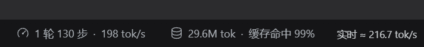
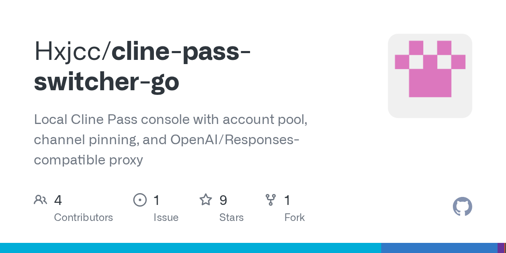

# cline pass钉住deepseek 焚决（目前反馈基本都成功）

> 原帖：https://linux.do/t/topic/3064863
> 发帖时间：2026-10-23T09:18:35.533Z
> 楼层：143（用 Discourse print 视图一次性抓全）
> 抓取时间：2026-10-30T02:18:50.618Z

文字与图片都是原帖内容，不是我的结论。我的结论在 `README.md`。

---

## #1 · @wanmu · 楼主 / 原帖

二更：

具体一点的

总结

顺便提一句：

还得是你gpt大人，gpt 6.1 sol 中，12分钟一轮出的

## #2 · @sunfly

期待一手详细内容

## #3 · @shathway

求个优惠码 之前一直忘记开了

昨天全部失效了 呜呜呜

## #4 · @tivans

cpa能钉死吗，dsh没用过

## #5 · @yrjjun

*（回复 #3）*

+1 求一个，大佬找到求踢一下我

## #6 · @Zephyr.Yu

关注一下，晚上试试

## #8 · @wanmu · 楼主

改了等级，顶一下，有号的佬友们可以试一下给个反馈

顺便也求一下优惠码

## #9 · @dark9253

我用佬友的方法试了下，貌似是可以钉住

用dsh+ds4.1flash max画的鹈鹕，用时3分50秒

## #10 · @Holiday_My

*（回复 #9）*

佬有设置方法吗？楼主发的看不懂

## #11 · @avantar

*（回复 #9）*

要用什么插件钉啊佬，在哪里下载

## #12 · @wanmu · 楼主

*（回复 #10）*

发给 ai 看看呢 ，我全程 ai 的

## #13 · @que2333

还真可以，用开源项目改了下确实钉住了。不过只能对1017有用，V4.1flash不行

## #14 · @dark9253

*（回复 #11）*

我用的magpie这个插件然后让ds结合楼主的方法自己修改了下

## #15 · @Muniesa

确实可以，伟大的发现

## #16 · @CncCbz

实测可行，配置完之后钉住deepseek了

## #17 · @koast18

厉害，看来是那个隐含缓存那个private渠道没有

唯一不好的就是我的clinepass今晚到期 现在只剩14%了 优惠码还没了…

## #18 · @ajiujiua

*（回复 #3）*

+1，搞来搞去这个cline pass是最划算的

## #19 · @xocky333

我也成功了，感谢大佬分享

## #20 · @zxclnp0711

感谢大佬 确实钉住了

## #21 · @DaoyiWeiwo

谢谢佬友，我让ai改了下cpa的插件，现在正常钉住了

## #22 · @Entelecheia

感谢佬，钉住了。

## #23 · @Nivooz

感谢佬 真的可以钉住了

## #24 · @zacharyz

表示没有看到什么意思

## #25 · @so_so

感谢佬友！成功钉住了，趁现在赶紧蹬了

## #26 · @xuyufenfei

如果用的是 Magpi 的话，可以安装 Param Override 插件，然后在已安装的选项里填

{
 "operations": [
 {
 "conditions": [
 {
 "mode": "contains",
 "path": "model",
 "value": "cline-pass/deepseek-v4.1-flash-1017"
 }
 ],
 "mode": "set",
 "path": "providerOptions",
 "value": {
 "gateway": {
 "has": [
 "vision",
 "implicit-caching"
 ],
 "only": [
 "deepseek"
 ]
 }
 }
 }
 ]
}

## #27 · @Aloys23

*（回复 #16）*

cpa在哪配置啊， ClinePassBridge插件

## #28 · @zcrdwx

成功加一，佬友的科研太伟大了

## #29 · @CncCbz

*（回复 #27）*

我是在下游pi里配的，配在请求体里

{
 "gateway": {
 "only": [
 "deepseek"
 ],
 "has": [
 "vision",
 "implicit-caching"
 ]
 }
}

## #30 · @person

现在的问题是，哪里有优惠码？

## #31 · @moyuan0115

感谢佬友分享,确实可以钉住

## #32 · @uptonking

我在 new-api 里面配置了，但请求返回的还是vmc/deepseek-v4p1-flash-1017-contributor-fallbacks 

{
 "providerOptions": {
 "gateway": {
 "only": [
 "deepseek"
 ],
 "has": [
 "vision",
 "implicit-caching"
 ]
 }
 }
}

## #33 · @juzzice

magpie测试成功 还得是佬友

## #34 · @Z.K

感谢佬 已美美钉上了

## #35 · @ydj1989591

*（回复 #13）*

请问这个是什么插件？怎么使用的，新手找不到门道

## #36 · @Greengage

*（回复 #33）*

佬可以分享一下做好的插件吗，workbuddy太笨了已经力竭了

## #37 · @Nicei

*（回复 #3）*

站内搜，有个帖子一直在更新

## #38 · @shathway

*（回复 #37）*

[https://linux.do/t/topic/2981867](https://linux.do/t/topic/2981867)

这个吗？都失效了捏

大佬也在爬取中 但是没有可用的

估计是特朗普的禁令搞的

## #39 · @marsfly

大佬牛批，刚刚让ai给我配置下，现在又可以用官渠了

## #40 · @liansishen

交给ai了，等待它的好消息，大佬牛批

## #41 · @yugaosi140

感觉没用啊 他显示是deepseek 但是实际token 还是100t/s

明显不是官方了 相当于只是改了显示

## #42 · @wanmu · 楼主

*（回复 #41）*

佬友我这边tps和缓存什么的看着都正常

之前这个号的key都是openai那个什么的，tps和缓存明显都低

## #43 · @juzzice

*（回复 #36）*

没有用额外插件，单独给ds1017配一下额外请求体

## #44 · @FlyLoongZ

确实钉住了，感谢佬友分享

## #45 · @GreatMaker

CPA的朋友如果加了lz说的两个参数后没效果可以检查cpa的配置中自己写的是cline-pass/deepseek-v4.1-flash，还是cline-pass/deepseek-v4.1-flash-1017,我加了参数之后将flash改成了flash-1017就可以了

## #46 · @mikss-beep

感谢，设置后就是请求的deepseek渠道了

## #47 · @Greengage

额外请求体看起来确实是加上了，可是好像还是没钉住

## #48 · @gangpula32

cline也部分官方，那和opencode一样啊。

## #49 · @vauntlek

实测没问题，感谢佬友！

## #50 · @Zephyr.Yu

卧槽，我钉不住。什么鬼，帖子为什么提示被举报了

## #51 · @JYPYYy

感谢佬，已经成功了

## #52 · @fastrun100

*（回复 #50）*

看样子账号也分“体质”。

我有个账号也钉不住，在CPA中用clinepassbridge查看后，上游只有一个托管方，没有候选列表。

另外一个可以钉住的账号，可以选择的托管方就比较多了，貌似只有这样的才能钉住。

## #53 · @puphou

在newapi中好像没钉住 ，主要clinepass自己那个vmc渠道完全不能调整思考等级，只能原生的deepseek渠道才行

## #54 · @annyc

#p-23970773-magpiecline-1那Magpie中Cline的配置似乎加额外请求体就好了

我自己测试是上游DeepSeek了。

{
 "providerOptions": {
 "gateway": {
 "only": [
 "deepseek"
 ],
 "has": [
 "vision",
 "implicit-caching"
 ]
 }
 }
}

## #55 · @sgd29932111

同样是6.1sol差距真大啊，我的只会研究1分钟然后告诉我目前没有可行的钉住上游的办法

## #56 · @wanmu · 楼主

*（回复 #55）*

这个也是抽卡了，只是恰好被我抽到了

## #57 · @2erTwo6

分享一个New API的配置方法，复制粘贴到参数覆写就可以

另外我这里还显式指定了思考强度默认为low，介意的自己用ai处理一下就好

{

“operations”: [

{

“path”: “reasoning_effort”,

“mode”: “set”,

“value”: “low”,

“keep_origin”: true

},

{

“path”: “providerOptions.gateway.only”,

“mode”: “set”,

“value”: [“deepseek”]

},

{

“path”: “providerOptions.gateway.has”,

“mode”: “set”,

“value”: [“vision”, “implicit-caching”]

}

]

}

## #58 · @aizimuji

cpa里面clinepassbridge有人成功的吗

## #59 · @koast18

*（回复 #32）*

它有一堆字段的 正常都是private vmc什么东西的 但是用了这个帖子就只有model是vmc/deepseek-v4p1-flash-1017-contributor-fallbacks 但是其他那些字段都变deepseek了

 FlyLoongZ:

确实钉住了，感谢佬友分享 

可以参考这个

## #60 · @ydj1989591

终于设置好了，最终还是让AI设置成功的，看样子好像是钉住了

## #61 · @liansishen

实测已经成功钉住上游，不知道能够用多久

## #62 · @VerliererK

雖然 CPA 還是顯示 vmc/deepseek-v4p1-flash-1017-contributor-fallbacks

實際回應

finalProvider=deepseek

canonicalSlug=deepseek/deepseek-v4.1-flash-1017

應該是成功了吧

## #63 · @Holiday_My

确实可用，给楼主点赞

## #64 · @mikss-beep

*（回复 #58）*

可以成功我是让dsh用ssh连接去修的，直接给佬的总结给它

## #65 · @purplespeed

字段
表示什么
你的实测结果

响应 model
网关返回的虚拟模型配置名称
vmc/…contributor-fallbacks

finalProvider
最终处理请求的上游
deepseek

canonicalSlug
网关报告的最终模型落点
deepseek/deepseek-v4.1-flash-1017

不确定是否成功了， magpie显示的还是vmc

## #66 · @XianYuDaXian

是不是被官方发现了，现在开始严重限流，几十tps的官方渠道也没用呀

## #67 · @wanmu · 楼主

*（回复 #66）*

我这用着看着还正常

## #68 · @lingdada

确实可以，但是速度还是比不上之前了，之前感觉可以稳定 250 左右的，那个速度确实酸爽

## #69 · @antior

axonhub应该如何设置呢？

## #70 · @XianYuDaXian

那也许是我的号被拉黑了，慢的受不了

## #71 · @RingoDHZ

虽然之前我的也是DeepSeek上游，但是改了之后明显速度快了，和楼上几个反过来了

## #72 · @daytime123

我最近也一直在用cline，但是可以问一下钉住这个有啥作用吗？

## #73 · @wanmu · 楼主

*（回复 #72）*

deepseek官方的token质量高，不降智，tps和缓存都高，效果好也省钱

## #74 · @daytime123

*（回复 #73）*

我用的套餐，模型选的cline-pass/deepseek-v4.1-flash-1017，意思是把它钉一下就成官方的了？

## #75 · @wanmu · 楼主

*（回复 #74）*

差不多这个意思

cline-pass/deepseek-v4.1-flash-1017有很多上游提供商，只有deepseek官方这个上游提供商效果好（体验差别很大），你不钉住它就很有可能给你路由到别的提供商，其它提供商基本上都速度慢、消耗快、效果差

## #76 · @rcins

倾向使用 [cline-pass-switcher](https://github.com/munmunjaklin458-afk/cline-pass-switcher) 的可以尝试 [我的fork](https://github.com/CCRcmcpe/cline-pass-switcher)。

## #77 · @AkaChou

magpie 钉失败了，试了很多种方法，看来还是要看账号～

## #78 · @yorksu

cpa 里面 clinepassbridge 可以更新到 0.4.0，就可以补这个字段了

## #79 · @fiytodie

有用啊，读图也快了很多，vmc的渠道读图卡死了

错了，这里AI帮我改成了余额扣费，难怪那么流畅

实际改动之后还是显示vmc，但是AI说跟官渠指纹一致，实测速度反正不如真官渠

## #80 · @alaha

按这个办法来之后，用国内直连速度就非常慢，但是改成过代理用国外IP反而非常快，不清楚原理。以前是钉住deepseek直接非常快。

## #81 · @ssxwcz

*（回复 #54）*

奇怪，我复制你的在magpie里钉不住，但在cpa里面又是可以的

## #82 · @cangying33

*（回复 #81）*

但是这个速度跟没钉住区别也不大了吧

## #83 · @ssxwcz

*（回复 #82）*

很奇怪，我用axonhub也设置了一下请求头，看到的模型还是vmc，但速度有200多了。。

## #84 · @flyfeel

*（回复 #76）*

佬 你的fork在哪？

## #85 · @ssxwcz

*（回复 #82）*

确实是钉住了上游了，我让dsf帮我分析了一下，现在要看 provider_metadata.gateway.routing.finalProvider 返回的是啥

鹈鹕风格也是dsf 1017的样子

## #86 · @ssxwcz

*（回复 #69）*

在渠道里面覆盖配置中覆盖下请求体就行，可以参考下我的，目前实测是200t/s以上，但是axonhub显示上游还是vmc，但实际到200t/s以上基本就是deepseek官方了，你也可以看请求日志-执行记录响应块中最后一个。

用其他覆盖请求体的软件如果看返回的上游还是vmc的，也可以去看看provider_metadata.gateway.routing.finalProvider，以这个参数为准

## #87 · @JadenWw

感觉 magpie 的响应体有解析问题，如果单看finalProvider 的确是 deepseek，只不过 cline 返回的响应体包含了 vmc和finalProvider=deepseek，其他的工具会取finalProvider这个值，magpie 没有取，后续看他们要不要优化了，目前对于 magpie 用户看着的确有点黑盒的感觉，而且magpie 上面的请求和响应也是有问题的，好像缺少了 请求的 extra_body 和响应的finalProvider字段

#p-23977628-sweat_smile-1原来是自动更新没打开

## #88 · @ssxwcz

*（回复 #87）*

magpie其实看上游就行了

## #89 · @yoluyou

有了，测试是有钉上的，谢谢大佬科研，太伟大了 

分享下自己 axonhub 的配置。

## #90 · @JadenWw

*（回复 #88）*

ok，原来自动更新没打开，我说怎么都没看到这一栏

## #92 · @hxjcc

[github.com](https://github.com/Hxjcc/cline-pass-switcher-go)
 

 
 
 

 [GitHub - Hxjcc/cline-pass-switcher-go: Local Cline Pass console with account pool,...](https://github.com/Hxjcc/cline-pass-switcher-go)

 Local Cline Pass console with account pool, channel pinning, and OpenAI/Responses-compatible proxy

 

 
 
 
 

 

适配了一下，需要的佬友可以看一下，还可以调用vercel的exa来给deepseek提供搜索

## #93 · @linode

成了 感谢！

## #94 · @jinyu30

返回确实是deepseek，但是目前速度只有170t左右，不知道什么情况

## #95 · @wanmu · 楼主

*（回复 #94）*

170 算正常的吧

## #96 · @Cynthia

*（回复 #94）*

感觉 Cline 的网关在搞事情， 我下午的时候用 230，和官网的完全一致。估计用的人多了，它在网关那边就会卡你的请求，增加延时

## #97 · @jinyu30

*（回复 #95）*

之前一直是200+，甚至能到300的

## #98 · @wanmu · 楼主

*（回复 #96）*

没有优惠码了，估计以后用的人就少了，唉

## #99 · @arxiv

钉住了 美滋滋了

## #100 · @zerger

*（回复 #4）*

佬，请问什么意思啊，钉住又是什么意思啊，求细讲下，谢谢佬

## #101 · @zerger

*（回复 #11）*

佬，请问钉住什么意思啊，求细讲下，谢谢！

## #102 · @626

*（回复 #100）*

就是钉住官方的渠道

有些人比较喜欢官渠

## #103 · @Xu_Li

*（回复 #89）*

我也是axonhub，请求体里有这个了，但是返回还是vmc渠道，不是deepseek

## #104 · @yoluyou

*（回复 #103）*

别看 response.model 那栏。

cline 直接是把 slug 改成 vmc 的，cline-pass/deepseek-v4.1-1017就变成固定返回 vmc/... 了。不管钉没钉住都是一样的。

要看的参数在 provider_metadata.gateway.routing.finalProvider。

routing.canonicalSlug 则是当佐证，表示钉住时是 deepseek/deepseek-v4.1-flash-1017，且掉到私有池是 private/...。

↑ 我让大肥鱼看几个有给钉住功能的项目，大概意思就是这样。

axonhub 要看的话，我记得要开储存所有响应块的功能还怎样，我记得我当时是开了一下，跑一个请求就关了。

然后让大肥鱼自己去数据库挖那个请求出来分析说有没有。

不管如何体感下来，我现在 200+ 的 tps，至少比 vmc 的 130+ tps 还舒服多了，首字反应也快一点了。

## #105 · @Bigfancy

*（回复 #104）*

6,真的钉住了，必须是1017那个模型，没有1017的那个钉不住。

## #106 · @WuliKay

也钉不住了 刚才设置了下

这个算钉住吗

## #107 · @Kreme

*（回复 #104）*

AxonHub 非流式请求，不需要存储所有响应块也可以看到字段。

## #108 · @diping

*（回复 #52）*

我也是这样，，没有候选列表的确实订不上

## #110 · @TD1000

*（回复 #26）*

貌似已经钉不住

## #111 · @diping

*（回复 #110）*

这个是聚合供应商的意思，你看具体返回，他会加一个具体的供应商反馈，我也是vmc，具体的上游就是ds

## #112 · @Greengage

*（回复 #47）*

实际好像这样就定住了，模型名是错的，渠道确实是钉到 deepseek 了

[@TD1000](https://linux.do/u/td1000)

## #113 · @TD1000

*（回复 #111）*

magpie tui在哪里看呀 没装gui

## #114 · @TD1000

*（回复 #112）*

主要是我看这个usage.jsonl文件中，之前的记录served中出现过deepseek/deepseek-v4p1-flash-1017，我就以为这几次是路由到vmc去了。

## #115 · @dfeiwej

1017的版本大家钉住了吗

## #116 · @sdwawq

钉得住，但是tps只有7/80左右，这速度太难受了。

## #117 · @a849033640

可以钉住 不错

## #118 · @Lzam345

应该是无了，刚刚看到定的上游从**vmc/deepseek-v4p1-flash-1017-contributor-fallbacks**

变成了cline-pass/deepseek-v4.1-flash-1017

并且不扣订阅额度直接走api积分，api余额用完就请求失败

## #119 · @tommy4

*（回复 #118）*

我也是一样，兴冲冲又原价开了一个结果还没开始就没法钉了

## #120 · @zacharyz

*（回复 #26）*

Param Override 插件 这个插件怎么安装，这个插件是什么

## #121 · @dkwork

你们真钉住的情况是被 route到 deepseek/deepseek-v4p1-flash-1017 ? 这个还是属于cline-pass下的route? 会不会就是这个因素所以扣的 Credits. 而不是真的钉住, 而是重新路由到付费的路径了?

## #122 · @xuyufenfei

*（回复 #120）*

就是 newapi 里面的覆写功能，可以覆写请求头和请求体，在 magpi 里面的插件，中间件

## #123 · @marsfly

依旧能钉住

## #124 · @fastsheep24

平时大多数时候稳定200，深夜早上能到300。11点变30tps 午餐deadline是吧？

## #125 · @sephiroth

来交作业了，给楼主点个赞

## #126 · @topniuniu

*（回复 #43）*

这个算钉住了吗？

我是直接开了这个的

## #127 · @baigy

*（回复 #126）*

我和你的一样，貌似钉不住了，我刚看之前的会话。

大概从里开始不行了

## #128 · @leejiqing

zcode设置 → 模型供应商 → cline → 模型列表里点 cline-pass/deepseek-v4.1-flash-1017 的「编辑模型配置」→ 高级设置 → 推理参数映射**。

钉deepseek：

reasoningLevel == “disabled”

? {

“thinking”: {

“type”: “disabled”

},

“providerOptions”: {

“gateway”: {

“only”: [“deepseek”],

“has”: [“reasoning”]

}

}

}

: {

“thinking”: {

“type”: “enabled”

},

“reasoning_effort”: reasoningLevel,

“providerOptions”: {

“gateway”: {

“only”: [“deepseek”],

“has”: [“reasoning”]

}

}

}

反向验证： 

reasoningLevel == “disabled”

? {

“thinking”: {

“type”: “disabled”

},

“providerOptions”: {

“gateway”: {

“only”: [“not-a-real-provider”],

“has”: [“reasoning”]

}

}

}

: {

“thinking”: {

“type”: “enabled”

},

“reasoning_effort”: reasoningLevel,

“providerOptions”: {

“gateway”: {

“only”: [“not-a-real-provider”],

“has”: [“reasoning”]

}

}

} 

ZCode 自己的日志里看不到 Cline 返回的 provider_metadata.gateway.routing.finalProvider——它对这个自定义 provider 只解析出空的 providerMetadata: {"new-provider": {}}，所以“这一条到底落在哪个上游”没法从 ZCode 日志直接读出来。

不知道起没起作用，心理安慰下。

## #129 · @chaixixi

clinepass现在还有便宜的渠道吗 2刀的要过期了

## #130 · @RyanGao

怎么今晚上用额度跑的飞快，大家伙有这个感觉吗？

## #131 · @dljx

*（回复 #130）*

笑死，像是没钉住一样，今天嘎嘎一下居然跑到周限了

## #132 · @samzhu

有没有佬出一个clinepass的，预算大概30左右，额度890这样

## #133 · @doow

现在还能钉吗？我试了改new-api的覆盖参数好像不行，另外现在掉缓存超严重，额度疯狂下滑中

## #134 · @FLSYD

*（回复 #133）*

还能钉住，这缓存命中和速度官方无疑了

## #135 · @sysy007uuu

我这也钉住了，就是为什么tps那么慢啊，比之前的private渠道还慢

## #136 · @sysy007uuu

好像不对劲，虽然钉住了，但是这个明显看着不是官渠（无法回答自己是deepseek，说自己是claude），tps也不到100

## #137 · @sysy007uuu

*（回复 #136）*

发现togetherai这个渠道挺猛的，tps有快300，智力也非常在线

## #138 · @SA2687890878

牛逼，有用了

## #139 · @elio_h

*（回复 #127）*

你用magpie 怎么钉住的？我安装帖子钉了，钉不住

## #140 · @IgniteRan

好像钉不住了，思维链是英文，tps160左右

配置没动过，之前能钉住的时候是

## #141 · @marsfly

不行了，焚决也失效了

## #142 · @Harson

*（回复 #141）*

 Xuyufenfei:

Param Override

是的。全是降级池。cline现在也鸡贼的厉害。

## #143 · @aizimuji

好像不行了, cpa里面也顶不住了, 昨天还可以

## #144 · @Bi_Diu

*（回复 #141）*

这个降级池是昨天ClinePassBridge更新刚加的，合了一个佬的PR

其实几天前就已经出现这个情况了

实测下来，降级池的账号貌似要弱智一点。做同一道数学题，降级池的耗时普遍比ds官方key要慢60%左右，目前还不知道是量化的模型还是tps慢

## #145 · @marsfly

*（回复 #144）*

opencode,command,clinepass一路用过来，没有一个能安稳用一个月的

## #146 · @7xWEcQ

*（回复 #139）*

已经钉不住了，cline 官方更新了

官方 ds 我工作流就发个 test 他都会调工具看看自己该干嘛，降级之后就是纯按提示词说自己是谁谁谁，区别还是很明显的，问他什么问题他也不太会主动去搜网页。
